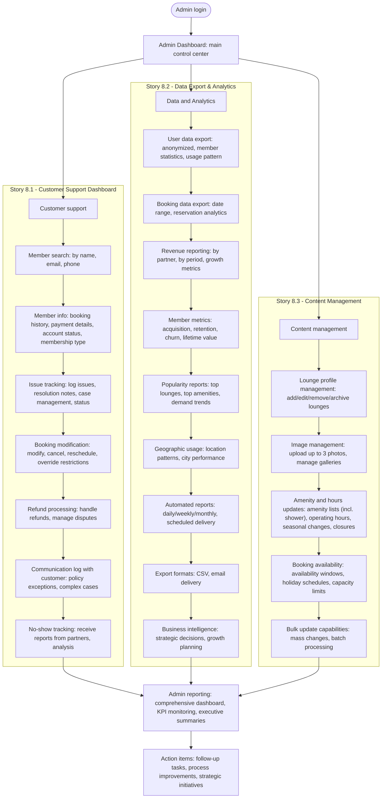

# Flow: Admin and Support Experience

**Original diagram:** [images/admin-support-experience.jpg](./images/admin-support-experience.jpg)
**Covers:** [Epic 8 - Admin & Support](../epic-8-admin-support/)

## Diagram

## Story Segments

| Story | Segment in diagram |
|---|---|
| [Story 8.1 - Customer Support Dashboard](../epic-8-admin-support/story-8.1-customer-support-dashboard.md) | Subgraph "Story 8.1": `Customer support` → `No-show tracking` |
| [Story 8.2 - Data Export & Analytics](../epic-8-admin-support/story-8.2-data-export-analytics.md) | Subgraph "Story 8.2": `Data and Analytics` → `Business intelligence` |
| [Story 8.3 - Content Management](../epic-8-admin-support/story-8.3-content-management.md) | Subgraph "Story 8.3": `Content management` → `Bulk update capabilities` |

## Notes

- All three stories branch independently from `Admin Dashboard` and converge at `Admin reporting` — they are parallel, not sequential.
- The original diagram carries several open design questions as sticky notes (e.g. how refunds are handled vs. Stripe, whether the admin can override lounge-set restrictions, how blackout dates are surfaced). These are unresolved product questions, not flow logic — flag them if implementing Epic 8.
