# Flow: Complete Booking Journey

**Original diagram:** [images/complete-booking-journey.jpg](./images/complete-booking-journey.jpg)
**Covers:** [Epic 3 - Lounge Profiles & Details](../epic-3-lounge-profiles-details/), [Epic 4 - Booking System](../epic-4-booking-system/), [Epic 5 - QR Code & Check-in](../epic-5-qr-code-check-in/), and touches [Epic 6 - Member Experience & Notifications](../epic-6-member-experience-notifications/) (no-show tracking only)
**Continues from:** [flow-location-discovery-search.md](./flow-location-discovery-search.md)

This is the longest diagram and the only one that spans multiple epics end-to-end: a member selects a lounge (Epic 3), books it (Epic 4), receives their pass and checks in (Epic 5), and the visit's outcome feeds into booking history (Epic 6).

## Diagram

```mermaid
flowchart TD
    LoungeSelected(["Lounge selected (from Epic 2)"]) --> LoungeDetails["Lounge details screen"]

    subgraph Story31["Story 3.1 - Detailed Lounge Information"]
        LoungeDetails --> HeroCarousel["Hero image carousel: min 3 quality images"]
        HeroCarousel --> BasicInfo["Basic info: lounge name, address, contact, hours highlighted, amenity icons"]
        BasicInfo --> RatingsReviews["Ratings and reviews: user rating + review count (if available)"]
        RatingsReviews --> QuickActions["Quick actions: Call, Directions (Google Maps URL), Share"]
    end

    subgraph Story32["Story 3.2 - Availability"]
        QuickActions --> CheckAvail["Check availability: real-time status check"]
        CheckAvail --> CurrentStatus{"Current status?"}
        CurrentStatus -->|Available| AvailIndicator["Available indicator: ready to book"]
        CurrentStatus -->|Not available| NotAvail["Not available: try different day/time"]
        AvailIndicator --> WeeklyCal["Weekly availability calendar: auto-refresh every 5 min, last updated timestamp"]
        NotAvail --> WeeklyCal
        WeeklyCal --> BookingRestrictions["Booking restrictions: advance notice, holiday/event closures, policies"]
        BookingRestrictions --> ReadyToBook{"Ready to book?"}
        ReadyToBook -->|No| BackToSearch["Back to search: continue exploring lounges"]
        ReadyToBook -->|Yes| BookNow["Book now: proceed to booking flow"]
    end

    subgraph Story41["Story 4.1 - Seamless Booking Flow"]
        BookNow --> BookingFlowScreen["Booking flow screen"]
        BookingFlowScreen --> DatePicker["Date picker: starting from today"]
        DatePicker --> AdmissionOne["Admission for one only"]
        AdmissionOne --> SpecialRequests["Special requests/notes: optional, 100 char limit"]
        SpecialRequests --> BookingSummary["Booking summary: review lounge, date/time, requests"]
        BookingSummary --> TermsPolicy["Terms and cancellation policy: must acknowledge"]
        TermsPolicy --> TermsAccepted{"Terms accepted?"}
        TermsAccepted -->|No| MustAccept["Must accept terms to proceed"]
        MustAccept --> TermsPolicy
        TermsAccepted -->|Yes| FinalAvailCheck{"Final availability check"}
        FinalAvailCheck -->|Full| Waitlist["Full: offer waitlist, or choose different date/time"]
        Waitlist --> DatePicker
        FinalAvailCheck -->|Available| OneTapConfirm["One-tap booking confirmation"]
        BookingFlowScreen -.-> ErrorHandling["Error handling: network issues, booking conflicts, system unavailability"]
        ErrorHandling --> RetryOptions["Retry options: try again, contact support, choose different time"]
        RetryOptions --> BookingFlowScreen
    end

    OneTapConfirm --> BookingConfirmed(["Booking confirmed: immediate confirmation screen"])

    subgraph Story51["Story 5.1 - Digital Pass Generation"]
        BookingConfirmed --> ConfirmGen["Confirmation generation"]
        ConfirmGen --> UniqueConfirm["Generate unique confirmation number (LP#)"]
        UniqueConfirm --> BookingInfo["Booking info: member name, lounge, date/time, duration, LP#"]
        BookingInfo --> EmailConfirm["Email confirmation: booking details + LP#, screenshot-friendly"]
    end

    subgraph Story43["Story 4.3 - Calendar Integration"]
        EmailConfirm --> AddToCal["Add to Calendar: iOS / Google / Outlook (.ics)"]
        AddToCal --> PrePopEvent["Pre-populated event: lounge name, address, directions link, LP#"]
    end

    PrePopEvent --> MyBookings["My Bookings section: accessible, screenshot-friendly"]

    subgraph Story53["Story 5.3 - Booking Reminder"]
        MyBookings --> Reminder24h["24-hour reminder email"]
    end

    subgraph Story52["Story 5.2 - Lounge Check-In Process"]
        Reminder24h --> BookingDay["Booking day arrives: member goes to lounge"]
        BookingDay --> PresentConfirm["Present confirmation at reception"]
        PresentConfirm --> StaffVerify["Staff verification + emergency contact info accessible to staff"]
        StaffVerify --> ValidBooking{"Valid booking?"}
        ValidBooking -->|Invalid| CheckInError["Check-in error"]
        CheckInError --> SupportContact["Support contact: resolve booking issue"]
        ValidBooking -->|Valid| CheckInSuccess["Check-in successful"]
        CheckInSuccess --> AppUpdate["Booking status updated in member's app"]
    end

    AppUpdate --> EnjoyLounge["Enjoy lounge experience"]
    EnjoyLounge --> BookingExpires["Booking expires automatically after booking window"]

    subgraph Story61["Story 6.1 - Booking Management (no-show only)"]
        BookingExpires --> NoShowTracking["No-show tracking: update booking history, track usage patterns"]
    end
```

## Story Segments

| Story | Segment in diagram |
|---|---|
| [Story 3.1 - Detailed Lounge Information](../epic-3-lounge-profiles-details/story-3.1-detailed-lounge-information.md) | `Lounge details screen` → `Quick actions` |
| [Story 3.2 - Availability](../epic-3-lounge-profiles-details/story-3.2-availability.md) | `Check availability` → `Book now` |
| [Story 4.1 - Seamless Booking Flow](../epic-4-booking-system/story-4.1-seamless-booking-flow.md) | `Booking flow screen` → `One-tap booking confirmation` (incl. error handling/retry) |
| [Story 4.2 - Payment Processing](../epic-4-booking-system/story-4.2-payment-processing.md) | **Not drawn in the original diagram.** Conceptually belongs between `Booking summary` and `Terms and cancellation policy` in the "Story 4.1" subgraph — see Notes below. |
| [Story 4.3 - Calendar Integration](../epic-4-booking-system/story-4.3-calendar-integration.md) | `Add to Calendar` → `Pre-populated event` |
| [Story 5.1 - Digital Pass Generation](../epic-5-qr-code-check-in/story-5.1-digital-pass-generation.md) | `Confirmation generation` → `Email confirmation` |
| [Story 5.2 - Lounge Check-In Process](../epic-5-qr-code-check-in/story-5.2-lounge-check-in-process.md) | `Booking day arrives` → `Booking status updated in member's app` |
| [Story 5.3 - Booking Reminder](../epic-5-qr-code-check-in/story-5.3.md) | `24-hour reminder email` |
| [Story 6.1 - Booking Management](../epic-6-member-experience-notifications/story-6.1-booking-management.md) | Only the `No-show tracking` end node — the rest of Story 6.1 (view/cancel bookings) has no dedicated diagram |

## Notes

- **Story 4.2 (Payment Processing) has no dedicated node in this diagram.** The original source material only lists its acceptance criteria as a text annotation on the Onboarding diagram (see [flow-onboarding.md](./flow-onboarding.md) Notes). Payment should logically occur during the "Story 4.1" booking flow, most likely right before or as part of `One-tap booking confirmation`. Treat this as a gap to confirm with design/product, not an intentional omission.
- The `Waitlist` branch (when a slot is full) corresponds to the "If full, option to be on the waitlist" acceptance criterion in Story 4.1.
- The check-in failure path (`Check-in error` → `Support contact`) is a dead end in the original diagram — it does not loop back into the main flow.
