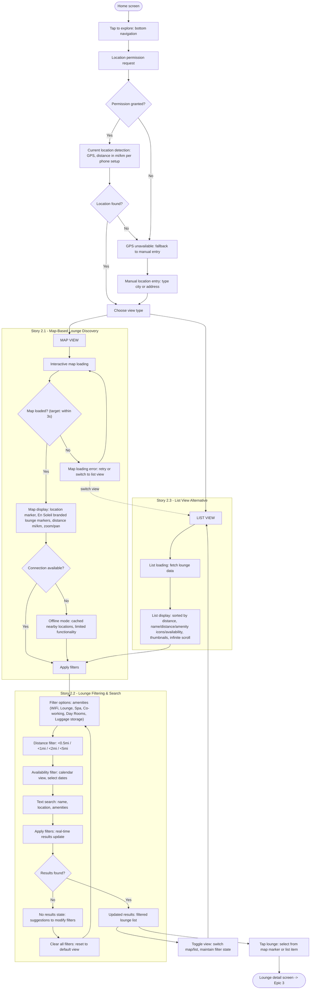

# Flow: Location Discovery & Search

**Original diagram:** [images/location-discovery-search.jpg](./images/location-discovery-search.jpg)
**Covers:** [Epic 2 - Location Discovery & Search](../epic-2-location-discovery-search/)
**Leads into:** [flow-complete-booking-journey.md](./flow-complete-booking-journey.md) (Epic 3)

## Diagram

## Story Segments

| Story | Segment in diagram |
|---|---|
| [Story 2.1 - Map-Based Lounge Discovery](../epic-2-location-discovery-search/story-2.1-map-based-lounge-discovery.md) | `MAP VIEW` → `Apply filters` (subgraph "Story 2.1"), including offline/error handling |
| [Story 2.2 - Lounge Filtering & Search](../epic-2-location-discovery-search/story-2.2-lounge-filtering-search.md) | `Filter options` → `Updated results` (subgraph "Story 2.2") |
| [Story 2.3 - List View Alternative](../epic-2-location-discovery-search/story-2.3-list-view-alternative.md) | `LIST VIEW` → `List display` (subgraph "Story 2.3") |

## Notes

- Both Map View and List View converge on the same filter pipeline (`Apply filters` → `Filter options` → ... → `Updated results`), so Story 2.2's filtering logic applies identically regardless of which view the member is using.
- Tapping a lounge (from either the map marker or a list item) exits this flow into `flow-complete-booking-journey.md`, starting at the "Lounge selected" node.
