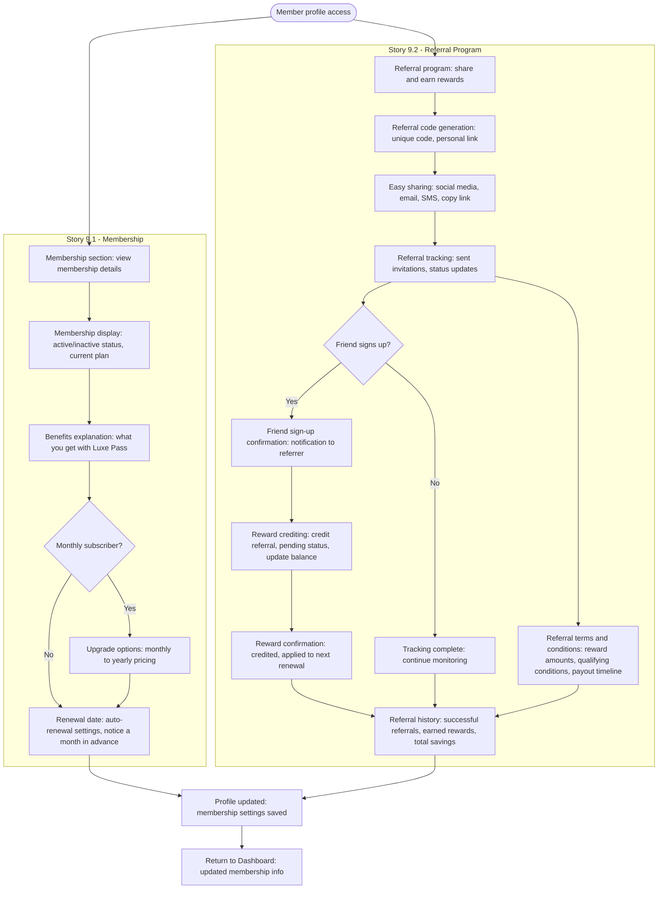

# Flow: Membership and Referrals

**Original diagram:** [images/membership-referrals.jpg](./images/membership-referrals.jpg)
**Covers:** [Epic 9 - Membership & Referrals](../epic-9-membership-referrals/)

## Diagram

## Story Segments

| Story | Segment in diagram |
|---|---|
| [Story 9.1 - Membership](../epic-9-membership-referrals/story-9.1-membership.md) | Subgraph "Story 9.1": `Membership section` → `Renewal date` |
| [Story 9.2 - Referral Program](../epic-9-membership-referrals/story-9.2-referral-program.md) | Subgraph "Story 9.2": `Referral program` → `Referral terms and conditions` |

## Notes

- The reward-crediting path (`Reward crediting` → `Reward confirmation` → `Referral history`) is marked with open-question flags in the original diagram — the exact reward mechanics (amount, trigger timing) were still pending at time of writing.
