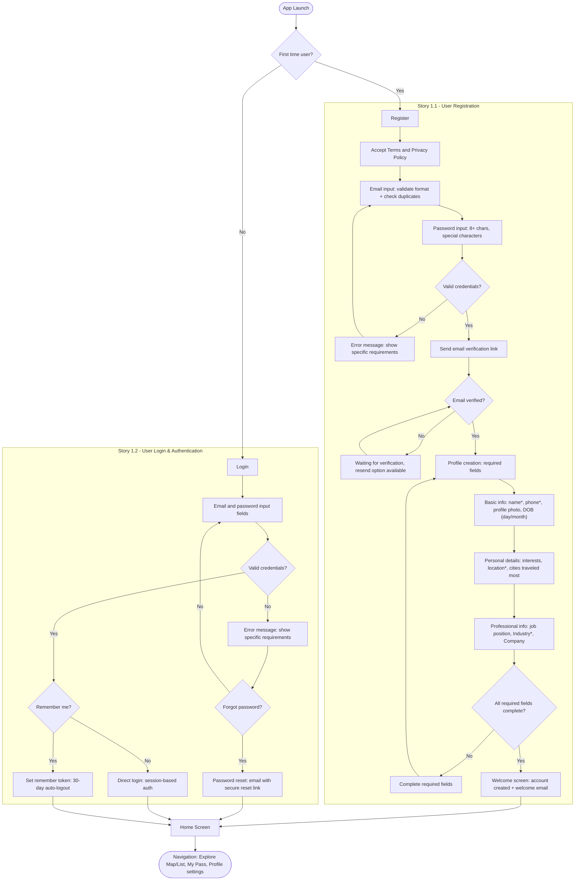

# Flow: Onboarding

**Original diagram:** [images/onboarding.jpg](./images/onboarding.jpg)
**Covers:** [Epic 1 - User Onboarding & Authentication](../epic-1-user-onboarding-authentication/)

## Diagram

## Story Segments

| Story | Segment in diagram |
|---|---|
| [Story 1.1 - User Registration](../epic-1-user-onboarding-authentication/story-1.1-user-registration.md) | `Register` → `Welcome Screen` (subgraph "Story 1.1") |
| [Story 1.2 - User Login & Authentication](../epic-1-user-onboarding-authentication/story-1.2-user-login-authentication.md) | `Login` → `Remember Token / Direct Login / Password Reset` (subgraph "Story 1.2") |

## Notes from original diagram (not modeled as flow nodes)

- Interests list, list of relevant cities, and "Other" free-input options are annotated on the `Personal details` step.
- Job position/Company free-input and an Industry dropdown list are annotated on the `Professional info` step.
- Near the `Navigation` end node, the original diagram has reference notes for future/related steps that are **not part of this flow**:
  - List of participating locations (top 5 + pictures) — admin-curated, relates to [Story 8.3 - Content Management](../epic-8-admin-support/story-8.3-content-management.md).
  - Map showing NYC + Miami as current locations.
  - Membership selection (Yearly/Monthly plan/Day Pass) — relates to [Story 9.1 - Membership](../epic-9-membership-referrals/story-9.1-membership.md).
  - Full text of [Story 4.2 - Payment Processing](../epic-4-booking-system/story-4.2-payment-processing.md) acceptance criteria is pasted as a documentation note here, but is **not wired into this flow** — see [flow-complete-booking-journey.md](./flow-complete-booking-journey.md) for where payment conceptually belongs in the booking sequence.
