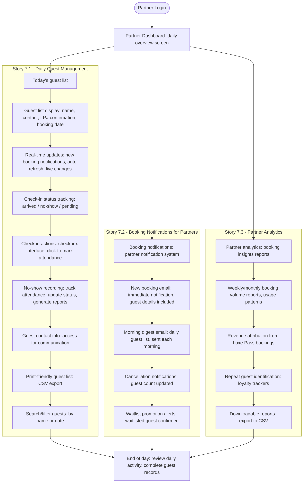

# Flow: Partner Experience

**Original diagram:** [images/partner-experience.jpg](./images/partner-experience.jpg)
**Covers:** [Epic 7 - Partner Dashboard](../epic-7-partner-dashboard/)

## Diagram

## Story Segments

| Story | Segment in diagram |
|---|---|
| [Story 7.1 - Daily Guest Management](../epic-7-partner-dashboard/story-7.1-daily-guest-management.md) | Subgraph "Story 7.1": `Today's guest list` → `Search/filter guests` |
| [Story 7.2 - Booking Notifications for Partners](../epic-7-partner-dashboard/story-7.2-booking-notifications-for-partners.md) | Subgraph "Story 7.2": `Booking notifications` → `Waitlist promotion alerts` |
| [Story 7.3 - Partner Analytics](../epic-7-partner-dashboard/story-7.3-partner-analytics.md) | Subgraph "Story 7.3": `Partner analytics` → `Downloadable reports` |

## Notes

- All three stories branch independently from the same `Partner Dashboard` and converge again at `End of day` — they are parallel, not sequential.
