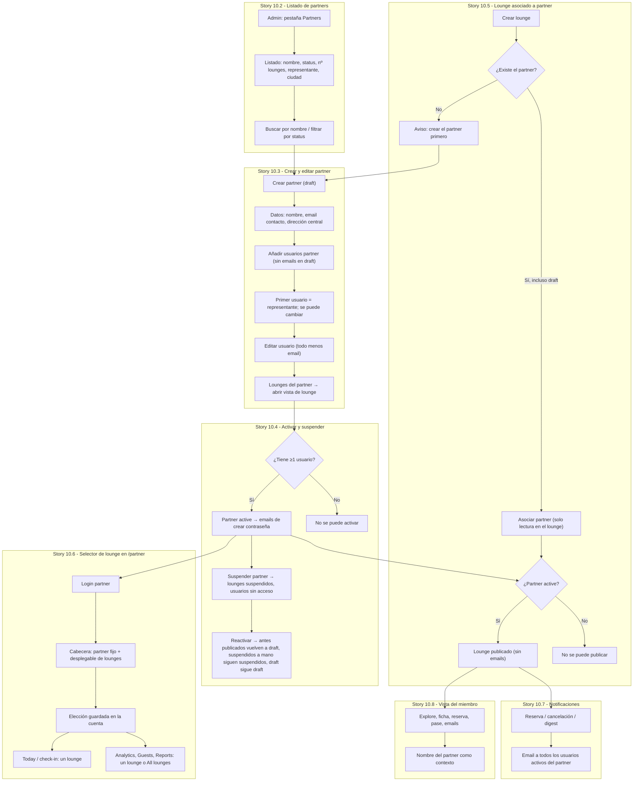

# Flow: Partner Organizations

**Covers:** [Epic 10 - Partner Organizations](../epic-10-partner-organizations/) — amplía Epic 7 (Partner Dashboard) y Epic 8 (Admin)

## Diagram

## Story Segments

| Story | Segment in diagram |
|---|---|
| [Story 10.1 - Modelo de organización partner](../epic-10-partner-organizations/story-10.1-modelo-organizacion-partner.md) | Transversal: modelo de datos y permisos que soportan todos los nodos |
| [Story 10.2 - Listado de partners](../epic-10-partner-organizations/story-10.2-listado-de-partners.md) | Subgraph "Story 10.2": `Admin: pestaña Partners` → `Buscar / filtrar` |
| [Story 10.3 - Crear y editar partner](../epic-10-partner-organizations/story-10.3-crear-y-editar-partner.md) | Subgraph "Story 10.3": `Crear partner` → `Lounges del partner` |
| [Story 10.4 - Activar y suspender](../epic-10-partner-organizations/story-10.4-activar-y-suspender-partner.md) | Subgraph "Story 10.4": `¿Tiene ≥1 usuario?` → `Reactivar` |
| [Story 10.5 - Lounge asociado a partner](../epic-10-partner-organizations/story-10.5-lounge-asociado-a-partner.md) | Subgraph "Story 10.5": `Crear lounge` → `Lounge publicado` |
| [Story 10.6 - Selector de lounge](../epic-10-partner-organizations/story-10.6-selector-de-lounge-partner.md) | Subgraph "Story 10.6": `Login partner` → `Analytics…` |
| [Story 10.7 - Notificaciones](../epic-10-partner-organizations/story-10.7-notificaciones-al-partner.md) | Subgraph "Story 10.7" |
| [Story 10.8 - Vista del miembro](../epic-10-partner-organizations/story-10.8-partner-en-la-vista-del-miembro.md) | Subgraph "Story 10.8" |

## Notes

- Orden de implementación: 10.1 primero; luego 10.2 → 10.3 → 10.4 → 10.5; 10.6, 10.7 y 10.8 dependen solo de 10.1.
- Sin artboard previo para 10.2, 10.3, 10.4 y 10.6: se diseñan con `/design` en `docs/design/epic-10-partner-organizations/` antes de implementar.
